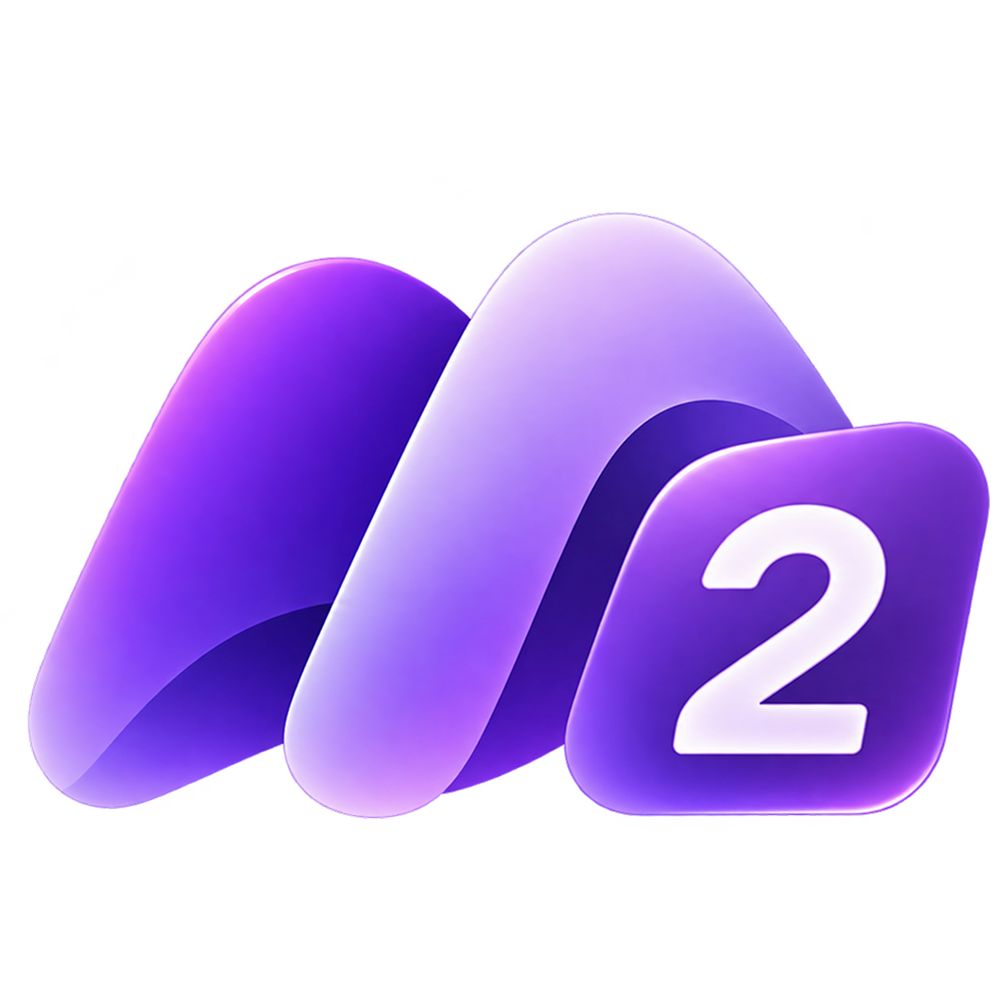

<!-- MiaDock 2 · Official public repository -->

  

  <h1>MiaDock 2</h1>
  
<strong>Your desktop. Your controls. Your way.</strong>

  
A compact, modular desktop dock for Windows 11. Media, sound, system controls and everyday tools — together in one place.

  
  
  
  
   
  
  
  

  

    <a href="https://mymiamo.net/miadock-2"><strong>Website</strong></a> &nbsp;·&nbsp;
    <a href="https://github.com/mymiamo/MiaDock-2/releases">Releases</a> &nbsp;·&nbsp;
    <a href="https://github.com/mymiamo/MiaDock-2/issues">Feedback</a> &nbsp;·&nbsp;
    <a href="#türkçe">Türkçe</a>
  

---

> [!NOTE]
> **MiaDock 2 is currently in development.** The features described here reflect the current product direction and may change before release. No public release is available in this repository yet.

## Overview

MiaDock 2 brings the information you need and the controls you use every day into a single, unobtrusive floating dock. Designed for Windows 11, it combines a compact interface with modular tools that expand when you need them.

More than a music widget, MiaDock is designed to make everyday desktop interactions feel simpler, more personal and more accessible.

## Key features

| Module | What it brings to your desktop |
| :--- | :--- |
| **Floating dock** | A compact interface at the top of your screen, designed to stay out of the way. |
| **Media center** | Track information and playback controls for compatible Windows media sessions. |
| **Synchronized lyrics** | Plain-text and time-synchronized lyrics from supported online providers, when available. |
| **Audio mixer** | Per-application volume controls, master volume and audio activity indicators. |
| **System controls** | Access to supported Wi-Fi, Bluetooth, microphone, battery and brightness information or controls. |
| **Time tools** | Timer, stopwatch and alarm tools for everyday routines. |
| **Focus profiles** | Customizable profiles for different workflows and desktop preferences. |
| **Personalization** | Apple-inspired, Mica, Acrylic and frosted-glass visual styles, with customization options. |
| **Localization** | English and Turkish interface support. |

Availability and behavior may depend on the final build, hardware, Windows version and external services.

<!-- MEDIA: When real screenshots are ready, add a Preview section here using relative image paths from assets/screenshots/. Do not link nonexistent images. -->

## Designed around your desktop

- **Compact by design:** quick access without occupying unnecessary screen space.
- **Modular by nature:** different tools in a consistent, customizable interface.
- **Local-first:** settings and application logs remain on your device; no separate MiaDock account is required.
- **Built for Windows:** native system and media integrations complement a modern interface.

## Availability & licensing

| | Details |
| :--- | :--- |
| Platform | Windows 11 |
| Release status | In development |
| Purchase model | Planned one-time purchase; no recurring subscription |
| License | Proprietary, closed-source; perpetual usage rights under the EULA |
| Distribution | Microsoft Store and developer-authorized channels |
| Updates | Published MiaDock 2.x updates are included; release frequency is not guaranteed |

The Microsoft Store listing and final system requirements will be announced when available. Follow the [official website](https://mymiamo.net/miadock-2) and [GitHub Releases](https://github.com/mymiamo/MiaDock-2/releases) for announcements. Obtaining files from GitHub alone does not grant a paid usage license.

## Privacy & online services

MiaDock 2 is designed around local processing. The application does not automatically send telemetry, usage statistics or crash reports to the developer. Settings and error logs are stored locally, and supported audio analysis runs on-device.

Some features require internet access, including lyrics lookups, update checks, Microsoft Store license validation and model downloads. Lyrics queries may send track title, artist and, when needed, album and duration to external providers. Online themes, icons and weather integrations are also being considered or developed. The relevant services may receive connection information such as IP addresses.

See the [Privacy Policy](./PRIVACY_POLICY_EN.txt) for details and the current status of online integrations.

## Technology

<strong>Explore the technology behind MiaDock 2</strong>

 

| Layer | Technologies |
| :--- | :--- |
| Desktop runtime | Electron |
| Interface | React, React DOM, TypeScript |
| Build tools | Vite, esbuild |
| Native Windows integration | C#, .NET 10, Windows GSMTC and Windows APIs |
| Audio processing | NAudio / WASAPI, Rust, RustFFT |
| Local audio analysis | Whisper.net, Spleeter models, ONNX Runtime |
| Icons | Lucide React, Ionicons |
| Testing | Vitest, Playwright, React Testing Library, jsdom |

These technologies are used in development; implementation details may evolve. Third-party software and models remain subject to their respective licenses.

## Feedback & support

MiaDock 2 is independently developed by **Eray Durupınar (mymiamo.net)**. Feedback helps shape the product.

- Report a bug or suggest a feature through [GitHub Issues](https://github.com/mymiamo/MiaDock-2/issues).
- Include your Windows version, MiaDock version (if applicable), expected behavior and steps to reproduce an issue.
- Do not post personal information, license credentials or unredacted logs publicly.
- For private support, licensing or privacy inquiries: [info@mymiamo.net](mailto:info@mymiamo.net).

This is the official public product repository, not the source-code repository. Source-code contributions and third-party code plugins are not accepted. Visual themes may be created within the permitted customization and license terms.

## Legal documents

| Document | English | Türkçe |
| :--- | :---: | :---: |
| Proprietary software license | [EN](./LICENSE_EN.txt) | [TR](./LICENSE_TR.txt) |
| End User License Agreement (EULA) | [EN](./EULA_EN.txt) | [TR](./EULA_TR.txt) |
| Privacy Policy | [EN](./PRIVACY_POLICY_EN.txt) | [TR](./PRIVACY_POLICY_TR.txt) |
| Trademark Notice | [EN](./TRADEMARK_NOTICE_EN.txt) | [TR](./TRADEMARK_NOTICE_TR.txt) |
| Third-Party Notices | [EN / TR](./THIRD_PARTY_NOTICES.txt) | [EN / TR](./THIRD_PARTY_NOTICES.txt) |

MiaDock 2 is not open-source software. The public availability of this repository does not grant access rights to proprietary source code or permission to redistribute the application. The EULA defines the permitted use of the software. Third-party components retain their own license terms. The privacy policy and third-party inventory remain subject to pre-release verification.

---

## Türkçe

**Masaüstün. Kontrollerin. Senin tarzın.**

MiaDock 2, Windows 11 için geliştirilen kompakt, modüler ve kişiselleştirilebilir bir masaüstü dock uygulamasıdır. Medya, ses, sistem durumu ve günlük araçları tek bir arayüzde bir araya getirerek önemli bilgilere ve kontrollere hızlı erişim sağlamayı hedefler.

> [!NOTE]
> **MiaDock 2 geliştirme aşamasındadır.** Burada belirtilen özellikler ürünün mevcut geliştirme kapsamını yansıtır ve yayın öncesinde değişebilir. Bu depoda henüz herkese açık bir sürüm yayımlanmamıştır.

### Öne çıkan özellikler

| Modül | Açıklama |
| :--- | :--- |
| **Floating dock** | Ekranın üst kısmında konumlanan kompakt ve modern arayüz. |
| **Medya merkezi** | Uyumlu Windows medya oturumları için şarkı bilgileri ve oynatma kontrolleri. |
| **Senkronize şarkı sözleri** | Desteklenen çevrim içi kaynaklardan, mevcut olduğunda düz metin ve zamanlamalı şarkı sözleri. |
| **Ses karıştırıcısı** | Uygulama bazlı ses ayarları, ana ses kontrolü ve ses etkinliği göstergeleri. |
| **Sistem kontrolleri** | Desteklenen Wi-Fi, Bluetooth, mikrofon, pil ve parlaklık bilgileri veya kontrolleri. |
| **Zaman araçları** | Zamanlayıcı, kronometre ve alarm. |
| **Odak profilleri** | Farklı çalışma düzenlerine uygun kişiselleştirilebilir profiller. |
| **Kişiselleştirme** | Apple yaklaşımından esinlenen, Mica, Acrylic ve bulanık cam görsel stilleri. |
| **Dil desteği** | Türkçe ve İngilizce arayüz. |

Özelliklerin kullanılabilirliği nihai sürüme, donanıma, Windows sürümüne ve harici servislere göre değişebilir.

### Yayın ve satın alma

MiaDock 2'nin tek seferlik satın alma modeliyle Microsoft Store ve geliştirici tarafından yetkilendirilmiş kanallarda sunulması planlanmaktadır. Geçerli lisans, sözleşme koşulları kapsamında süresiz kullanım hakkı sağlar. Yayımlanan 2.x güncellemeleri ek ücret gerektirmez; güncelleme sıklığı garanti edilmez. GitHub üzerinden dosya edinmek tek başına ücretli kullanım hakkı sağlamaz.

Microsoft Store bağlantısı ve nihai sistem gereksinimleri hazır olduğunda duyurulacaktır. Gelişmeleri [resmî web sitesinden](https://mymiamo.net/miadock-2) ve [GitHub Releases](https://github.com/mymiamo/MiaDock-2/releases) bölümünden takip edebilirsin.

### Gizlilik

MiaDock 2 yerel çalışma yaklaşımıyla tasarlanmıştır. Ayrı bir MiaDock hesabı gerektirmez; uygulama telemetri, kullanım istatistiği veya hata raporlarını geliştiriciye otomatik olarak göndermez. Ayarlar ve hata kayıtları cihazda saklanır. Desteklenen ses analizi işlemleri yerel olarak yürütülür.

Şarkı sözleri, lisans doğrulama, güncelleme kontrolü ve model indirme gibi işlemler internet bağlantısı gerektirebilir. Şarkı sözleri için parça adı, sanatçı ve gerektiğinde albüm ile süre bilgisi harici sağlayıcılara iletilebilir. Çevrim içi tema, ikon ve hava durumu servisleri de geliştirme kapsamındadır. Harici servisler IP adresi gibi bağlantı bilgilerini işleyebilir.

Ayrıntılar ve kesinleşmemiş entegrasyonlar için [Gizlilik Politikası](./PRIVACY_POLICY_TR.txt) belgesine bakabilirsin.

### İletişim ve geri bildirim

MiaDock 2, Eray Durupınar tarafından mymiamo.net markası altında bağımsız olarak geliştirilmektedir. Hata bildirimlerini ve özellik önerilerini [GitHub Issues](https://github.com/mymiamo/MiaDock-2/issues) üzerinden paylaşabilirsin. Herkese açık bildirimlerde kişisel bilgi, lisans bilgisi veya sansürlenmemiş hata kaydı paylaşma.

Teknik destek, lisans ve gizlilik konuları için: [info@mymiamo.net](mailto:info@mymiamo.net).

Bu depo, MiaDock 2'nin herkese açık ürün merkezidir; kaynak kodu deposu değildir. Yazılım kapalı kaynaklıdır. Kullanım hakları [Türkçe EULA](./EULA_TR.txt) kapsamında belirlenir. Diğer hukuki belgelerin Türkçe ve İngilizce sürümleri yukarıdaki [belge tablosunda](#legal-documents) yer alır.

---

  
  
<strong>MiaDock 2</strong> Independently developed for Windows 11.

  
Copyright © 2026 Eray Durupınar (mymiamo.net). All rights reserved. / Tüm hakları saklıdır.

  
Independent software inspired by modern desktop experiences. Not affiliated with or endorsed by Apple or Microsoft.

  <a href="https://mymiamo.net">mymiamo.net</a> &nbsp;·&nbsp;
  <a href="https://mymiamo.net/miadock-2">MiaDock 2</a> &nbsp;·&nbsp;
  <a href="mailto:info@mymiamo.net">Contact</a>

